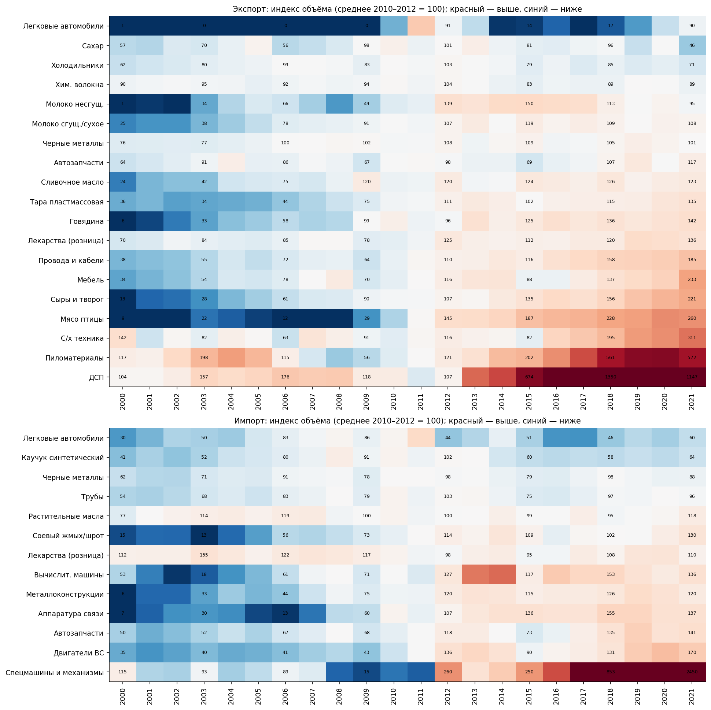

# Экспорт и импорт важнейших видов продукции Беларуси, 2000–2021

Анализ данных Национального статистического комитета Республики Беларусь: 19 позиций экспорта и 13 позиций импорта в натуральных единицах (тыс. т, тыс. м³, тыс. шт. и т. д.), 2000–2021 гг. Единицы у позиций разные, поэтому ряды сравниваются через индексы, темпы роста и корреляции приростов. Экспорт легковых автомобилей (в штуках) переведён в тыс. шт. для сопоставления с импортом.

Запуск: `pip install -r requirements.txt && python src/analysis.py` (графики сохраняются в `charts/`).

## Графики

| № | Файл | Что показывает |
|---|------|----------------|
| 1 | `01_export_small_multiples.png` | Динамика всех позиций экспорта |
| 2 | `02_import_small_multiples.png` | Динамика всех позиций импорта |
| 3 | `03_cagr.png` | Среднегодовые темпы роста 2000–2021 |
| 4 | `04_index_heatmap.png` | Индекс объёма (среднее 2010–2012 = 100) |
| 5 | `05_export_structural_shifts.png` | Агропродовольственный, древесный и промышленный экспорт |
| 6 | `06_cars_export_vs_import.png` | Легковые автомобили: экспорт и импорт |
| 7 | `07_common_products_balance.png` | Товары, представленные и в экспорте, и в импорте; сальдо |
| 8 | `08_growth_correlation.png` | Корреляция годовых приростов (Спирмен) |
| 9 | `09_shock_years.png` | Изменения в 2009, 2015 и 2020 гг. |
| 10 | `10_anomaly_zscore.png` | Аномальные годовые приросты (z-score) |

## Ключевые тренды

**Экспорт**
- Главный драйвер роста — продовольствие: говядина 6,8 → 157,4 тыс. т (×23), мясо птицы 6,8 → 189,6 тыс. т (×28), сыры и творог 16,9 → 298,3 тыс. т (×17,6). У сыров нет ни одного годового спада глубже −8%.
- Быстрее всего в последнее десятилетие росла древесина: пиломатериалы 280 тыс. м³ (2008) → 4 057 (2020), ДСП 92 тыс. м³ (2011) → 1 893 (2017). Среднегодовой рост 2010–2021: ДСП +22,9%, пиломатериалы +19,9%. В 2021 г. оба ряда ниже пика (пиломатериалы −15% к 2020, ДСП −25% к 2017).
- Мебель выросла в 6,9 раза (до 904 млн долл. в 2021 г.), сельхозтехника — в 2,2 раза (рост 13% в год с 2010 г.).
- Стагнируют химические волокна (150 → 148 тыс. т), чёрные металлы (+1,3% в год), холодильники (пик 1 017 тыс. шт. в 2012 г., к 2021 г. −31%). Сахар в 2000–2021 гг. снизился на 20% (256 → 206 тыс. т).
- Несгущённое молоко выросло с 1,7 до 325 тыс. т (2015) и затем упало до 206 тыс. т (−37%), тогда как сыры продолжали расти.
- 17 из 32 рядов достигли исторического максимума в 2019 г. или позже.

**Импорт**
- Электроника и техника растут: аппаратура связи 258 тыс. → 5,1 млн шт. (×20, пик 5,8 млн в 2019), двигатели внутреннего сгорания ×4,9, автозапчасти ×2,8, металлоконструкции ×21.
- Наиболее стабильны растительные масла (коэффициент вариации 0,10), лекарства (0,11) и чёрные металлы (0,17).
- Импорт отходов при извлечении соевого масла вырос с 50 до 423 тыс. т (×8,4) — единственная сырьевая позиция с устойчивым трендом.

## Зависимости

**Экспорт и импорт одних и тех же товаров** (график 7)

| Товар | Экспорт / импорт, 2000 | Экспорт / импорт, 2021 | Корреляция уровней |
|---|---|---|---|
| Лекарства | 79% | 157% | 0,03 |
| Легковые автомобили | 0,9% | 51% | 0,40 |
| Автозапчасти | 119% | 78% | 0,71 |
| Чёрные металлы | 64% | 60% | 0,72 |

Экспорт лекарств вырос почти вдвое (6 024 → 11 760 т) при неизменном импорте (7 650 → 7 500 т). По автозапчастям страна из нетто-экспортёра стала нетто-импортёром. Чёрные металлы — устойчивый нетто-импорт при высокой корреляции уровней.

**Реакция на внешние шоки** (медианный прирост к предыдущему году по всем рядам, график 9)

| Год | Экспорт | Импорт |
|---|---|---|
| 2009 | +3,1% | −19,5% |
| 2015 | +3,1% | −14,7% |
| 2020 | +7,2% | −5,7% |

Импорт реагирует на кризисы сильнее экспорта. В 2009 г. экспорт продовольствия вырос (мясо птицы +237%, говядина +81%, молоко +62%), а промышленные позиции просели: экспорт мебели −42%, ДСП −31%, импорт автозапчастей −33%, вычислительных машин −30% (в 2015 г. −64%). В 2020 г. заметнее всего просели автозапчасти (экспорт −20%, импорт −18%).

**Корреляция годовых приростов** (график 8, Спирмен, 2001–2021)
- Сильнее всего связаны металлоёмкие позиции импорта: трубы ↔ чёрные металлы (0,82), автозапчасти ↔ чёрные металлы (0,79), каучук ↔ металлоконструкции (0,77).
- Экспорт мебели движется вместе с импортом чёрных металлов (0,75) и автозапчастей (0,64).
- Отрицательные корреляции (например, экспорт сливочного масла ↔ импорт двигателей, −0,56) при 21 наблюдении — скорее случайные совпадения.

**Соевые отходы и животноводческий экспорт.** Уровни импорта соевых отходов сильно коррелируют с экспортом говядины (0,91), мяса птицы (0,84), сыров (0,88) и сухого молока (0,93). С 2010 г. и по приростам связь почти исчезает (0,01–0,38), поэтому это совпадение трендов, а не доказанная зависимость.

## Аномалии

Список наиболее аномальных годовых приростов — на графике 10.

- **Экспорт легковых автомобилей:** 8 шт. (2009) → 23,9 тыс. → 112,7 тыс. (2011) → 59 тыс. (2012) → 4,1 тыс. (2017) → 58,5 тыс. (2021). Одновременно импорт достиг 284 тыс. в 2011 г. и упал на 71% в 2012 г. (график 6). Всплеск экспорта и импорта в одни и те же годы указывает на связанные потоки.
- **Импорт «машин и механических устройств специального назначения»:** 6–9 тыс. шт. (2008–2011) → 1 356 тыс. шт. (2020), около 150 раз. Такой разрыв больше похож на изменение состава товарной группы, чем на реальный рост; как тренд использовать этот ряд некорректно.
- **Импорт вычислительных машин:** 2,4 → 5,6 → 6,1 млн шт. в 2012–2014 гг. и обвал на 64% в 2015 г. — единовременный всплеск.
- **Экспорт сахара:** −54% в 2021 г. (445 → 206 тыс. т) после +60% годом ранее; ряд самый «пилообразный» (2019: 278, 2020: 445).
- **Экспорт ДСП:** +210% в 2013 г. (132 → 410 тыс. м³) — начало структурного скачка.
- **Экспорт несгущённого молока:** +1 606% в 2001 г. (1,7 → 29 тыс. т) — эффект очень низкой базы.
- **Данные 2019 г.:** у говядины (140,165447) и мяса птицы (170,371655) значения приведены с лишней точностью, в отличие от остальных рядов. Похоже на пересчёт двух позиций; стоит сверить с первоисточником.

Причины аномалий в данных не видны; их объяснение требует внешних источников.
